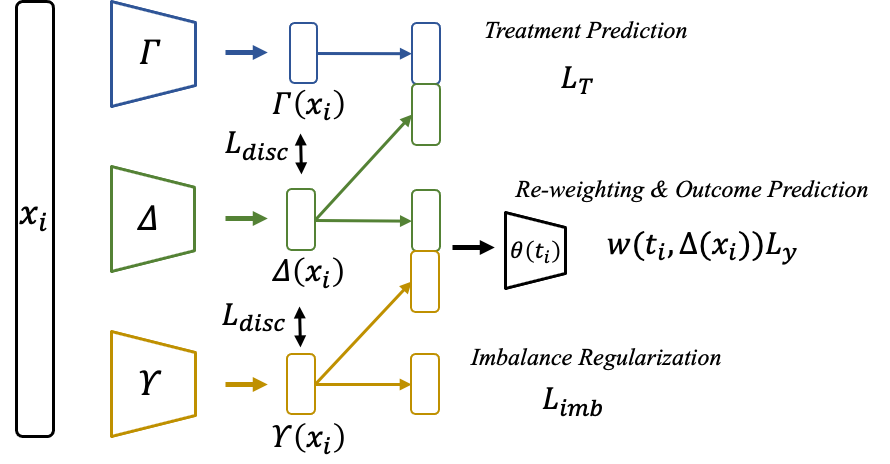
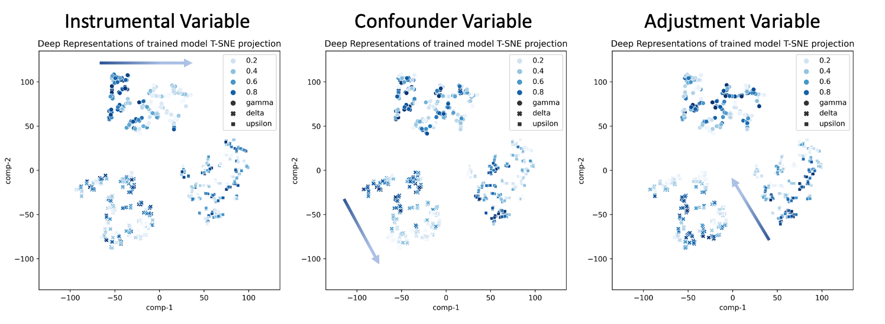

# DTRNet
We investigate the problem of generating appropriate disentangled representations that adjust for the selection bias precisely to estimate the individual treatment effect with continuous treatments. We propose a novel Disentangled Representation Network (DTRNet) for ITE estimation with continuous treatments. DTRNet learns disentangled representations and controls the selection bias precisely. The architecture and some results of our model is as follows:
 


## Environment (conda)
We export the conda environment used for running this code:

- `environment.DTRNET_FINAL.full.yml` (recommended, fully specified)
- `environment.DTRNET_FINAL.history.yml` (minimal, from-history)

Create and activate:

```bash
conda env create -f environment.DTRNET_FINAL.full.yml
conda activate DTRNET_FINAL
```

## Notes on GPU / CPU
Some machines may have an older NVIDIA driver that cannot initialize CUDA with the installed PyTorch build. The training scripts in this folder were updated to **fall back to CPU** automatically when CUDA init fails.


This code is based on VCnet: https://github.com/lushleaf/varying-coefficient-net-with-functional-tr/blob/main/README.md#how-to-run

# How to run

## To run the experiment with simulated data:

-- generate simulated data

python simu1_generate_data.py

-- train and evaluating the methods


python DTRNet_main.py


## To run the experiment with ihdp data:
-- generate ihdp data

python ihdp_generate_data.py

-- train and evaluating the methods

python DTRNet_ihdp.py

## To run the experiment with news data:
-- generate ihdp data

python news_generate_data.py

-- train and evaluating the methods

python DTRNet_news.py

# To plot the disentangle plot 

The disentangled_plot_news.py and disentangled_plot_ihdp.py scripts are for generating Figure 5, while disentangled_plot_main.py is for Figure 4. Please note that the code is provided as an example for plotting; you will need to replace the model path with your own trained model path in the files. Feel free to experiment with different combinations of x and y choices.

## Tips:

To control the number of dataset that you want to run, adjust num_dataset in argparse in the file.



# Baselines

For most of the baselines in the paper, we used the code released at https://github.com/lushleaf/varying-coefficient-net-with-functional-tr and https://github.com/hlzhang109/TransTEE.


# Citation

    @article{
    anonymous2024dtrnet,
    title={{DTRN}et: Precisely Correcting Selection Bias in Individual-Level Continuous Treatment Estimation through Reweighted Disentangled Representation},
    author={Hu, Mengxuan and Chu, Zhixuan and Li, Sheng},
    journal={Transactions on Machine Learning Research},
    year={2024},
    url={https://openreview.net/forum?id=1ZTfzA9bXw},
    }
